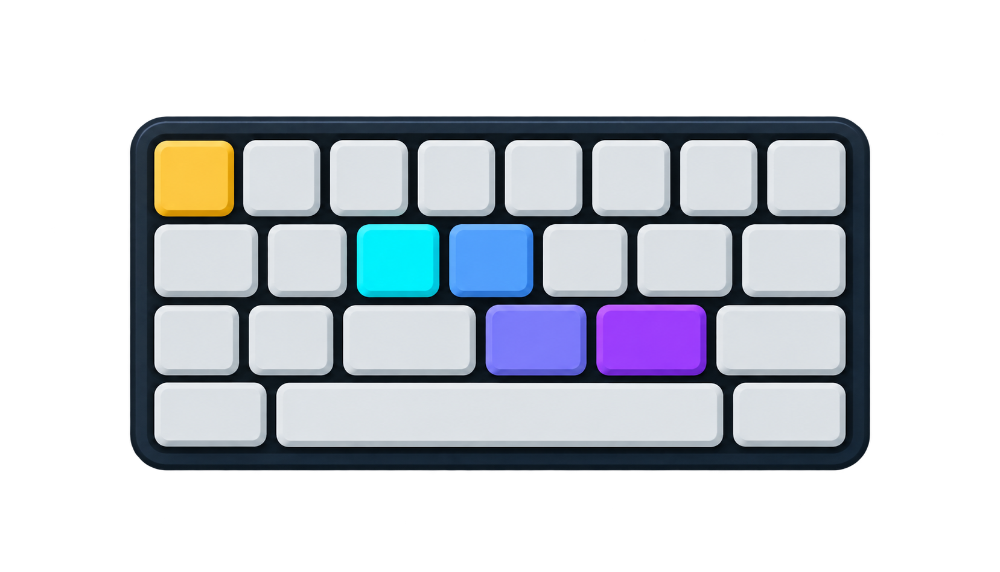

<p align="center">
  
</p>

# Keyflux

[English](README.md) | **简体中文**

本地 AI 状态灯伴侣，使用面向 macOS / Windows 的 Zig 核心，将 Agent 活动映射为键盘灯光，并为键盘、AI 接入和灯效提供独立扩展入口。

**当前阶段：v0.1 内部验证，已支持 macOS / USB / 固件 4.0.18.6 / Mac 档的 Kick75 IO 手动主灯测试。** 常亮变色、精确配置回读和原灯效恢复已通过实机验证。自动 AI 灯控仍未放行；桌面 App 现支持 macOS 下经验证的手动 USB 主灯控制；真实 Codex 桌面阶段、写入持久化与完整设备生命周期仍待验证。

## 当前能力

- Zig 状态引擎：多会话汇总、工具与审批关联、结束回合的迟到事件隔离。
- 仅供离线开发测试的模拟键盘：相同写入去重、持久化恢复日志、强制终止后的恢复。
- NuPhy USB HID 只读枚举，以及实验性的 Kick75 IO（`19f5:1026`）主灯驱动：手动常亮、精确回读、完整原态持久恢复。
- Codex hook 适配器，以及可选的本机鉴权 OTLP/HTTP 接收器，支持 JSON 和 protobuf 日志。
- Tauri 2 + React/TypeScript 共享设置界面：按型号预览、逐状态 RGB／亮度编辑、主键区与侧灯独立配色及原生文件对话框；Kick75 使用提取的几何与本地缓存的 NuPhy 参考素材，未验证的布局示例不进入 App 型号目录。
- 版本化的事件、键盘型号和主题契约，附校验工具及贡献指南。

Thinking 必须来自明确的 reasoning 事件；沉默、经过时间或没有工具调用都不能证明正在思考。完成色表示回合结束，不代表结果一定正确。

## 平台与技术

| 组件 | 技术／当前状态 |
| --- | --- |
| 核心 | Zig **0.17.0**，由 [.zigversion](.zigversion) 固定 |
| HID 传输 | 随仓库提供 HIDAPI，采用其 BSD 许可选项 |
| 桌面界面 | Tauri 2 + React／TypeScript／Vite；薄 Rust 桥接、原生托盘、系统 WebView |
| macOS | macOS 13+，Apple Silicon 开发构建；WKWebView |
| Windows | 共享界面与 Zig 核心，依赖 WebView2；原生构建和设备实机验证须独立验收 |
| 本地 IPC | macOS Unix socket；Windows 当前用户权限限制的 named pipe |

打包后不依赖 Python、Node.js、外部浏览器、产品账号或模型 API key；界面使用系统 WebView，Windows 需要 WebView2。Node.js 与 Rust 用于构建，Python 用于核心开发工具和测试；基础 USB 枚举不需要输入监控或辅助功能权限。

## 快速开始

核心需要 Zig 0.17.0；桌面界面另外需要 Node.js 24+、Rust stable 和平台 SDK（macOS 使用 Xcode Command Line Tools，Windows 使用 MSVC 构建工具与 WebView2）。

```sh
git clone --branch dev https://github.com/zhanbodev/Keyflux.git
cd Keyflux
zig build -Doptimize=ReleaseSafe
zig build test
./zig-out/bin/keyflux diagnose
./zig-out/bin/keyflux replay examples/session.jsonl
./zig-out/bin/keyflux serve --simulate
```

`replay` 使用固定时间戳的测试材料，输出 `working → thinking → output → complete`。`serve --simulate` 在前台运行，只改变模拟设备。

在另一个终端进入仓库根目录：

```sh
./zig-out/bin/keyflux status
./zig-out/bin/keyflux preview thinking
./zig-out/bin/keyflux theme-set examples/theme.json
./zig-out/bin/keyflux theme-get
./zig-out/bin/keyflux stop
```

默认运行数据目录：

| 平台 | 目录 |
| --- | --- |
| macOS | `~/Library/Application Support/Keyflux` |
| Windows | `%LOCALAPPDATA%/Keyflux` |

服务端与客户端均可传入 `--state-dir PATH` 隔离实例。Unix socket 路径应保持简短。不要把固定日期的回放材料当成实时适配器事件；实时事件须生成当前 Unix 纳秒时间和唯一 event ID，见[扩展规范](docs/EXTENSIONS.zh-CN.md#ai-事件适配器)。

### 真实 Kick75 IO 主灯（实验性）

```sh
./zig-out/bin/keyflux hardware-probe              # 只读固件和灯光配置
./zig-out/bin/keyflux hardware-status             # 只读设备与磁盘恢复记录摘要
./scripts/test-kick75-macos.sh                    # 构建、三色测试、校验并恢复
./zig-out/bin/keyflux hardware-solid '#06B6D4' 15
./zig-out/bin/keyflux hardware-restore
```

使用 USB、固件 **4.0.18.6** 和 **Mac 档**，先关闭其他灯控客户端。测试脚本使用 15% 亮度，保留侧灯，退出或中断时恢复原灯态。直接调用 `hardware-solid` 会保持颜色，直到调用 `hardware-restore`。原态日志写入默认数据目录；实体修改命令拒绝 `--state-dir`，保证多个进程共用同一份原态。进程被强制终止后，连接原键盘与同一 USB 端口，再显式恢复。

固件会量化 RGB：CLI 同时报告请求值与 `color_quantized`，严格校验请求值或已知量化值，并在需要时通过逆向编码精确恢复原 RGB。详见[协议、恢复规则与剩余门槛](docs/hardware/kick75.md)及[实机证据](docs/evidence/kick75-main-20261026.json)。Windows／Win 档、Flash 持久化、睡眠／拔插恢复及 AI 自动实体灯控尚未开放。

### 共享桌面设置应用

```sh
npm --prefix desktop ci
./scripts/dev-macos.sh
# Windows 也可使用的跨平台入口：
node desktop/scripts/dev.mjs
```

脚本在独立开发目录启动**真实只读核心**。用户点击“连接键盘”后，才只读识别实际 USB 设备，启动时不自动连接。连接成功前只显示中性键盘轮廓和连接入口，配色、亮度、导入导出、保存及灯控操作均锁定。正式前端没有模拟设备或浏览器 fixture 入口。

连接后，窗口可见时约每 4.5 秒回读一次 USB；检测到拔出立即锁定控制，并停止设备探测，用户再次点击连接后才重新识别。断开前的配色草稿会保留。“设备回读”显示实际主灯模式、亮度及常亮色，与正在编辑的配色草稿分开。App 重启后若发现原态记录，必须先点击“恢复灯效”再改色；不匹配或损坏的恢复记录会阻止写入。

键盘区无卡片背景、不悬浮、不允许选区或选键。下方白色控制台在支持的窗口尺寸内一屏显示，左侧纵向切换“主键区／条形灯”，状态列表去除 HEX，右侧使用自绘饱和度/明度、色相条、RGB、预设和最近颜色。下拉菜单由 App 绘制。主灯呈现为彩色键帽轮廓而非整键填色；两侧虚构灰条已删除，仅在启用条形灯预览时显示右侧小开口示意。

已验证的 USB Kick75／macOS／Mac 档／4.0.18.6 可点击“应用到键盘”，通过现有 Zig 驱动捕获原态、严格回读；“恢复灯效”恢复原主灯配置。断开或正常退出会恢复由该 App 接管的主灯。连接、编辑或保存主题均不自动写入实体颜色。未知固件与 Windows 保持只读；条形灯仍仅配置和屏幕预览。“跟随状态”目前驱动预览，不会自动写入 HID。

```sh
./scripts/dev-macos.sh --no-build       # 复用已构建的 Zig sidecar
./scripts/dev-macos.sh --no-ui          # 真实只读核心，不打开界面
./scripts/dev-macos.sh --no-ui --demo   # 显式合成事件，仅 CLI 调试
./scripts/dev-macos.sh --check          # 软件检查，不写实体 HID
sh scripts/package-macos.sh            # 本地 release .app
```

关闭设置窗口保留托盘、核心及手动应用的主灯颜色；从托盘重新打开。退出 App 或在启动终端按 Ctrl+C 结束受监督的开发会话。强制终止后保留恢复日志，接回原键盘及 USB 端口后点击“恢复灯效”。产物位于 `desktop/src-tauri/target/{debug,release}/bundle/macos/Keyflux.app`，使用本地 ad-hoc 签名，未 Apple 公证。

[桌面开发与命令边界](docs/DESKTOP.md)提供详细说明。旧 `macos/` SwiftUI 仅保留为历史参考。NuPhy 美术为经哈希校验且不入 Git 的本地缓存，**不属于 MIT 内容，也未完成公开分发授权**，见[第三方声明](THIRD_PARTY_NOTICES.md#nuphy-io-preview-artwork)。

### Windows 核心

在安装了 Zig 0.17.0 的 Windows 仓库目录运行：

```powershell
zig build -Doptimize=ReleaseSafe
.\zig-out\bin\keyflux.exe serve --simulate
```

也可以从开发主机交叉编译：

```sh
zig build -Dtarget=x86_64-windows-gnu -Doptimize=ReleaseSafe --prefix zig-out/windows
```

Ubuntu 等开发系统可用 `zig test src/tests.zig` 验证纯 Zig 核心。macOS 运行时构建需要 Apple SDK，交叉构建时使用 `-Dmacos-sdk=PATH` 指定；当前不提供 Linux HID 运行时。

## Codex 接入

生成待审查的配置片段：

```sh
./zig-out/bin/keyflux setup-codex "$PWD/zig-out/bin/keyflux"
```

该命令不实施配置修改。按 [Codex 接入指南](docs/CODEX.md) 保留已有 hooks/exporter 设置、审查并信任 hooks，再验证实际桌面版本。

使用 `keyflux serve --simulate --otlp-port 4318` 启动可选接收器。它仅监听 `127.0.0.1`，Bearer token 保存在实例目录的 `otlp-token` 中，请勿分享该文件。接收器只保留结构字段，不保存提示词、对话正文和工具内容；Keyflux 不自动上传遥测。

真实桌面事件覆盖、会话关联、导出延迟和自动来源崩溃检测仍需验证。模拟输入不能证明这些能力已可用。

## 扩展 Keyflux

从 **[扩展接口规范](docs/EXTENSIONS.zh-CN.md)**（[English](docs/EXTENSIONS.md)）开始：

| 扩展类型 | 贡献方式 |
| --- | --- |
| 键盘型号 | 型号描述文件、准确的设备／固件证据与校验结果 |
| 键盘协议 | 实现 `KeyboardDriver` 的 Zig 驱动、测试和恢复证据 |
| AI 接入 | 任意语言适配器，通过 CLI／本地 IPC 提交 `AgentEvent v1` |
| 配色主题 | `Theme v1/v2` JSON，校验后导入，无需重新编译 |
| 动态灯效 | 后续 renderer 契约；逐键输出和蛇形效果尚未实现 |

键盘屏幕布局提供独立的 [KeyboardPreview v1 规范](docs/specs/keyboard-preview-v1.md)与 `python3 scripts/validate-keyboard-previews.py` 校验器。预览布局不等于硬件兼容，也不包含固件 LED 索引。

描述文件不能执行任意 HID 命令，也不会自动启用驱动。当前没有外部二进制插件加载器或稳定插件 ABI。验收清单见 [CONTRIBUTING.md](CONTRIBUTING.md)，机器可读契约见 [schemas/](schemas)。

## 验证与路线

```sh
zig build test
python3 tests/integration.py zig-out/bin/keyflux
python3 scripts/check-vendor.py
./zig-out/bin/keyflux validate-model models/nuphy-kick75-io.json
./zig-out/bin/keyflux validate-theme examples/theme.json
./zig-out/bin/keyflux gate examples/release-gates.json
```

最后一个命令预期退出 **2**：它检查自报发布证据，不解锁硬件驱动。测试仅使用临时数据、本机通信和模拟设备；Windows 集成测试传入对应的 `.exe` 路径。

已有模拟基准记录：空闲 CPU 约为单核 0.08%，驻留内存约 11.6 MiB，CLI 到模拟确认 P95 约 7.8 ms。这些数字不包含真实 HID、Codex 导出延迟或实体灯色变化。详见[验收记录](docs/VALIDATION.md)及[原始基准](docs/evidence/simulated-performance-20261026.json)。

| 版本 | 里程碑 |
| --- | --- |
| v0.1 | 内部核心、模拟、诊断、事件探针和扩展契约 |
| v0.2 | Kick75 主灯与真实 Codex 阶段验证通过后的 macOS Alpha |
| v0.3 | Windows Alpha、原生托盘／设置和实机验证 |
| v0.4 | 已验证逐键布局与蛇形动画模式 |
| v0.5 | Claude Code、DeepSeek 等 Harness 适配器和社区设备 |
| v1.0 | 稳定接口、兼容矩阵、迁移恢复和签名发行 |

首发硬件目标是一把 USB 有线 Kick75 **NuPhyIO**。QMK/VIA 版本、蓝牙／2.4 GHz 灯控、普通 ChatGPT 对话监听和侧灯效果不计入首发范围。完整路线见 [ROADMAP](docs/ROADMAP.md)。

## 许可

[MIT](LICENSE) © 2026 Nuclx Tech。HIDAPI 采用其 BSD 许可选项；来源与许可边界见[第三方声明](THIRD_PARTY_NOTICES.md)。本项目与 NuPhy、OpenAI、Anthropic、DeepSeek 无官方隶属关系。
